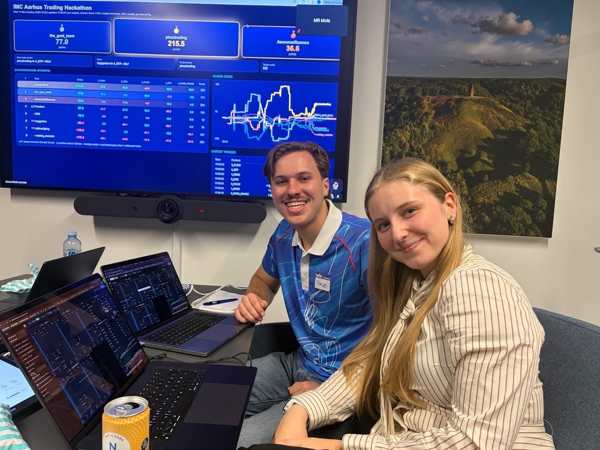
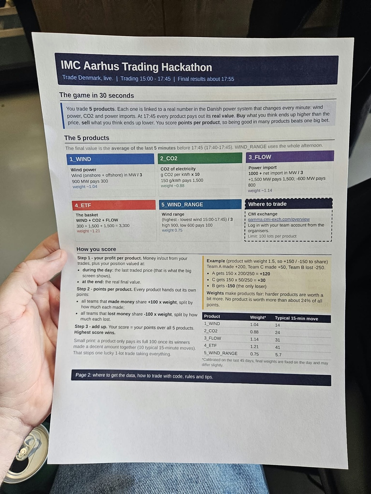
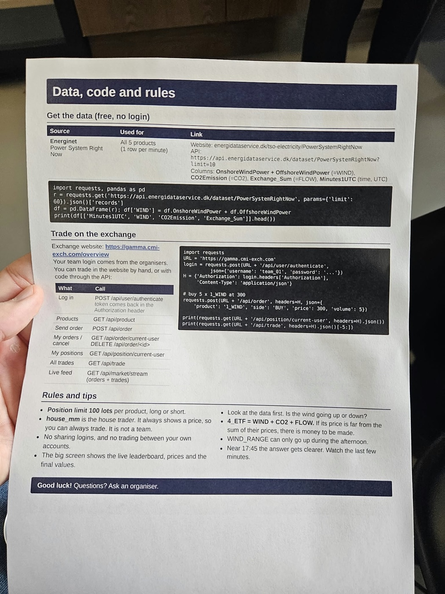
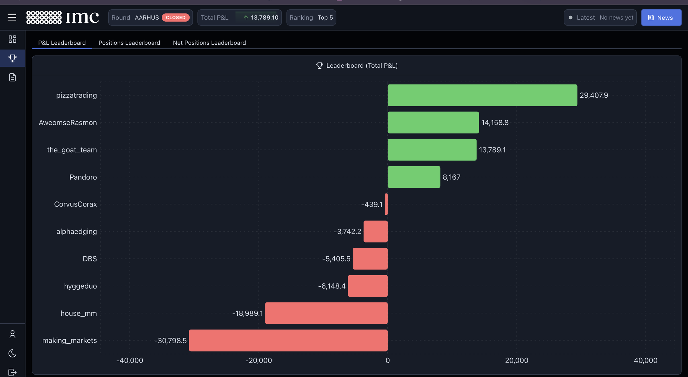
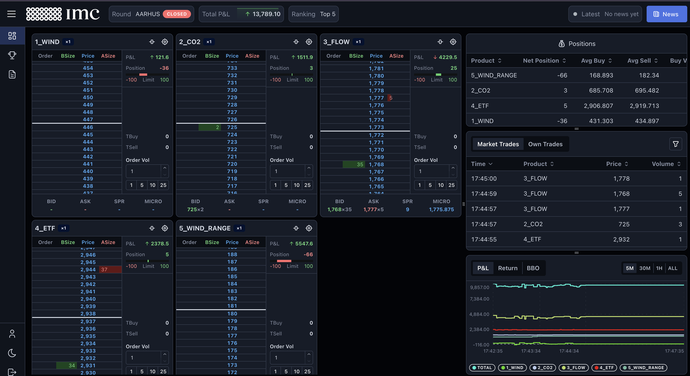
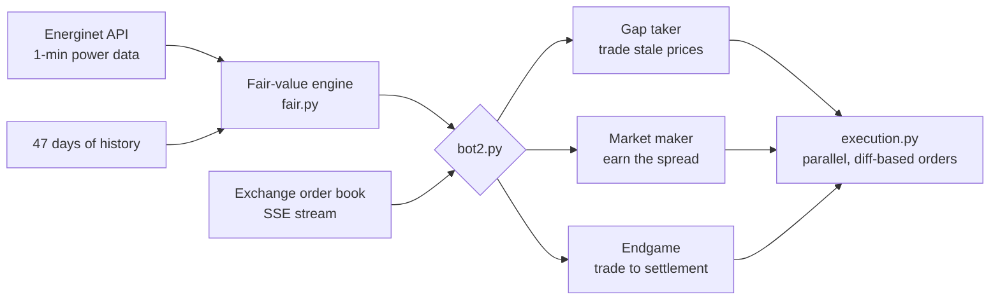

<div align="center">

# 🥈 IMC Aarhus Trading Hackathon: 2nd Place

### An automated trading bot for live markets built on real Danish power-grid data

**Team `the_goat_team`** · IMC Trading, Aarhus · 11 November 2026




</div>

---

## 👋 Team

| | |
|---|---|
| **Jakub Piotrowski** | [](https://www.linkedin.com/in/jakub-piotrowski97/) |
| **Teammate** | [](https://www.linkedin.com/in/semikiina/) |

---

## ⚡ TL;DR

We had **2 h 45 min** to trade 5 products against 8 other teams, a house market maker and volatility bots.
Each product settled on **real, live data from the Danish power grid** (wind, CO₂, imports).

- 🔍 **The edge we found:** market prices lagged the real data by **2–3 minutes**. We predicted the next minutes and traded the gap.
- 🤖 **The bot:** a statistical "nowcast" plus market making plus an endgame model that locked in the settlement as it was published.
- 🛡️ **Recovered from a −6,000 drawdown** with hard risk limits and "backtest before you ship" discipline.
- 🏁 **Finished 2nd on points, with +13,789 P&L and all five products profitable.**

---

## 🎮 The game

| Product | What it tracks (Energinet *PowerSystemRightNow*, 1 row/min) |
|---|---|
| `1_WIND` | (onshore + offshore wind MW) / 3 |
| `2_CO2` | CO₂ intensity (g/kWh) × 10 |
| `3_FLOW` | 1000 + net power imports (MW) / 3 |
| `4_ETF` | WIND + CO2 + FLOW (a basket) |
| `5_WIND_RANGE` | (max − min wind MW, 15:00–17:45) / 3, which can only go up |

- **Settlement:** the average of the 5 minutes 17:40–17:44.
- **Position limit:** ±100 lots per product.
- **Scoring is per product:** profitable teams share +100 × weight in proportion to their profit, and losing teams share −100 × weight. So **every product had to end positive.**

<details>
<summary>📄 Official handouts</summary>
<br>
 
</details>

---

## 🏆 Results

<div align="center">

<br><em>Final P&L leaderboard: the_goat_team +13,789 (2nd on points, 3rd on raw P&L)</em>
<br><br>

<br><em>Our dashboard at the close: all five products profitable</em>
</div>

| Product | P&L at close |
|---|---|
| 1_WIND | +122 |
| 2_CO2 | +1,512 |
| 3_FLOW | +4,230 |
| 4_ETF | +2,379 |
| 5_WIND_RANGE | +5,548 |
| **Total** | **+13,789** |

---

## 🧠 Strategy



### 1. Forecasting: what will 17:40–17:45 look like?
- **47 days of Energinet history**, backtested at every time of day.
- **AR(1) nowcast:** the data is published about 75 s late, so we predict the *unpublished* minutes. That beat persistence by **4–12%**; CO₂ trends strongly (lag-1 autocorrelation of 0.61).
- **Endgame model:** a minute-level forecast that **locks in each settlement minute as it's published**, so its uncertainty shrinks toward zero. It was calibrated over 12 days, with z-score sd ≈ 1.

### 2. Gap taker: trading on stale prices
Market mids followed the *last published* value with a **2–3 minute lag**. When a new data minute moved the value, we took the stale quotes. It was positive on **7 of 7 replayed days**, and CO₂ was the main source.

### 3. Market making: earning the spread
- **Quotes:** placed one tick inside the best price when the spread allowed, with inventory skew and a hard cap of 10 lots.
- **Order handling** (`execution.py`): only changed quotes are cancelled and re-sent, in parallel, which keeps our queue position. Sending 10 orders took **~150 ms instead of ~2 s**.
- **Adverse-selection protection:** we found one team that traded on information (prices moved about +18 per lot in their favour afterwards). We widened quotes in the data-publish window and never quoted through our nowcast.
- **When the organisers' volatility bots joined,** we **replayed the recorded order book** to retune spreads before going live. ETF market-making P&L roughly doubled.

### 4. Endgame: trading toward the settlement
From 17:20 the bot traded toward the settlement value, with the take threshold tightening from **1σ to 0.5σ** and the cap rising to 98. `WIND_RANGE` became **mathematically locked**: wind couldn't reach its session high or low in time. So we **sold it above its certain value**, which became our best product.

---

## 📈 How the day went

| Time | What happened |
|---|---|
| 15:00 | Practice round. We built the repo, the fair-value model and the first bot live |
| 16:00 | **The real round started.** The exchange reset and we re-registered |
| 16:05–16:20 | ❌ Oversized FLOW bet in a thin market: **−6,000** |
| 16:20 | 🛑 Stopped, measured everything, added hard caps. Only backtested changes from then on |
| 16:30 | Discovered the 2–3 min market lag, then the nowcast and gap taker went live |
| 16:58 | 🤖 The volatility bots joined; we replayed the book data and retuned |
| 17:20 | 🎯 Endgame model on, with the threshold tightening as uncertainty shrank |
| 17:45 | 🏁 **2nd place, all 5 products positive** |

---

## 🗂️ Repository structure

```
├── bot2.py              # main bot: gap taker + market maker + endgame (event-driven)
├── execution.py         # parallel, diff-based order manager (keeps queue priority)
├── fair.py              # fair value + sigma: research models, AR(1) nowcast, endgame schedule
├── endgame.py           # minute-level settlement model (locks published minutes)
├── params.json          # every strategy knob, hot-reloaded live (no restarts)
├── predict.py / pnl.py  # live prediction table & P&L marked 3 ways
├── watch.py             # regime watcher: new participants, rate spikes
├── copy_pizza.py        # experiment: follow the informed trader (tight risk limits)
├── sim/                 # 47-day historical backtester
└── research/            # every experiment we ran, one folder each:
    ├── wind/ flow_co2/  #   per-product forecasting models
    ├── endgame/ blend/  #   settlement model + model comparison
    ├── lagged_bt/       #   lagged-market strategy backtest (47 days)
    ├── mm/              #   order-book replay backtester for market making
    ├── live_stats/      #   live gap-signal statistics
    ├── opponents/ pizza/#   participant markouts & behaviour
    └── yesterday/       #   full-strategy replay of past days + calibration
```

## ▶️ Running it

```bash
bash setup_mac.sh                      # Python 3.12 venv + deps
cp .env.example .env                   # CMI_USER / CMI_PASS (never commit)
.venv/bin/python predict.py            # 17:45 predictions from every model
DRY=1 .venv/bin/python -u bot2.py      # dry run: prints decisions, sends nothing
./restart.sh bot2.py                   # live: guarantees exactly one bot
.venv/bin/python -I research/yesterday/replay_day.py 2026-11-10   # replay a past day
```

---

## 💡 Lessons learned

1. **Measure before you trade.** Every real edge (the lag, noise-bot flow, the locked range) came from data analysis, not intuition.
2. **In a thin market, size kills.** Hard caps from the first minute would have saved our −6k.
3. **Backtest before you ship, even mid-competition.** A replay of 10 minutes of order-book data beat any amount of guessing.
4. **Know your scoring function.** Per-product scoring meant "all five positive" mattered more than one big bet.
5. **Don't fight your own bot.** Manual trades caused our only self-inflicted clash.

---

## 🙏 Acknowledgements

Thanks to **IMC Trading** and the organisers for a great event. The exchange (CMI), the Python starter (`base_bot.py`, `models.py`, setup scripts) and the market design are theirs. Data is from [Energinet's open data service](https://www.energidataservice.dk/tso-electricity/PowerSystemRightNow).

<div align="center">
<sub>Built in one afternoon. If you're into trading, data or ML, let's connect on LinkedIn! 👆</sub>
</div>
